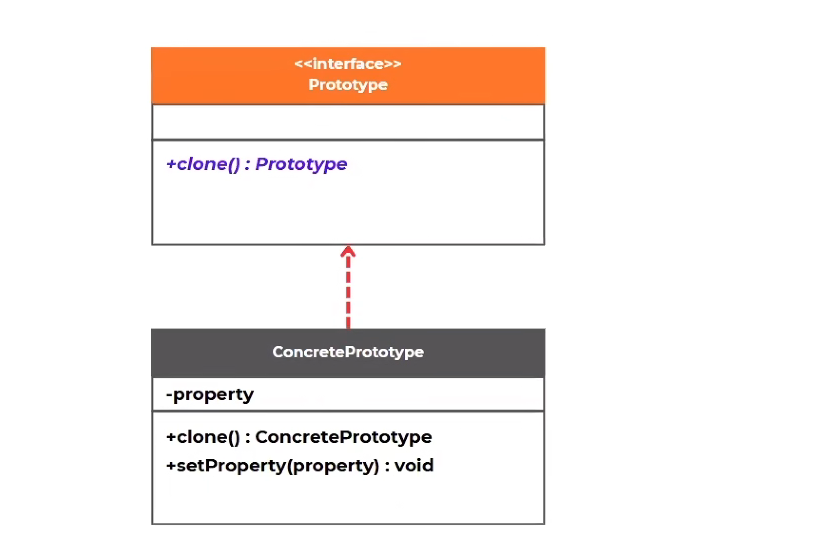
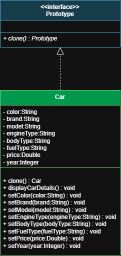
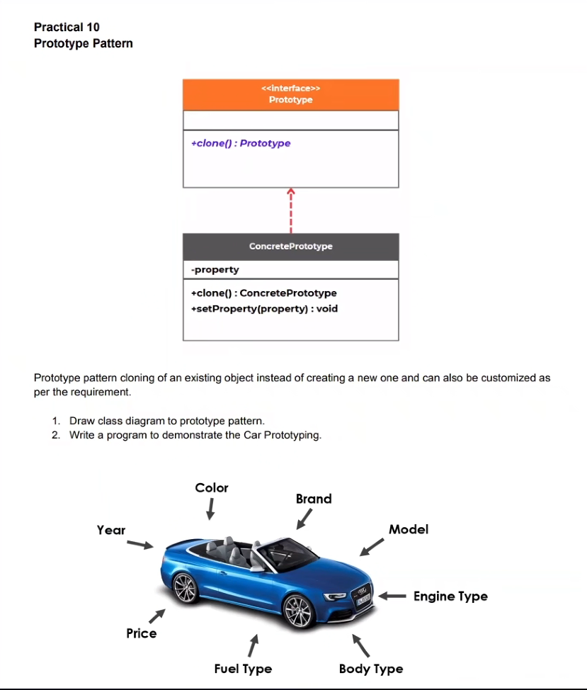
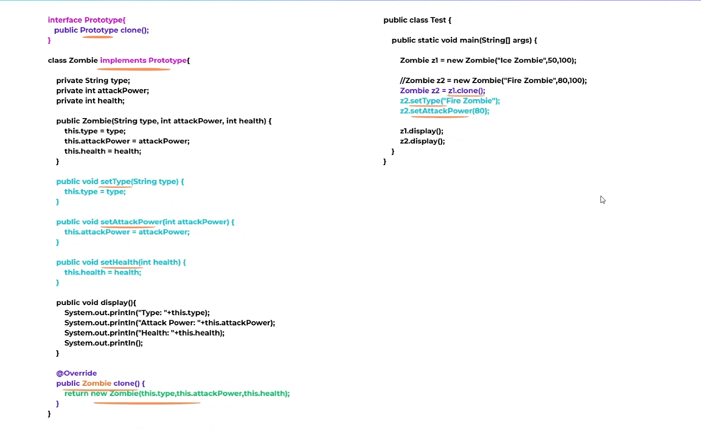

# Prototype Design Pattern

## Theory note
The Prototype Design Pattern is a creational design pattern that helps create new objects by cloning an existing object instead of constructing a new one from scratch. It is useful when object creation is expensive, complicated, or when many objects share the same initial configuration.

The main idea is simple:
- Create one base object (prototype)
- Clone it whenever a similar object is needed
- Modify only the differences

This pattern reduces repetition, improves performance, and keeps object creation flexible.

## Why use the Prototype Pattern?
When an object has many attributes and setting up a new instance takes time or complex logic, the prototype pattern is a better choice. Instead of re-running initialization code, you clone the existing object and customize it as required.

## Suitable cases
Use this pattern when:
- Creating a new instance is expensive or slow
- Objects have many shared properties
- You need multiple variants of the same object
- You want to avoid repeated initialization logic
- The object structure is relatively simple and cloneable

Examples:
- Car manufacturing with different color, model, or engine options
- Game characters and enemy objects
- Document templates in editors
- Configuration objects in applications
- Object pools or cached templates

## Not suitable
Avoid this pattern when:
- Object creation is simple and cheap
- The object contains complex, hidden state that is hard to clone correctly
- The object graph has deep references or shared resources that need special handling
- The class hierarchy changes frequently and cloning logic becomes difficult to maintain
- The object depends on external resources that should not be duplicated

## Advantages
- Reduces costly initialization work
- Faster object creation
- Easier creation of similar object variants
- Keeps object creation logic centralized
- Helps maintain consistent default values

## Disadvantages
- Cloning can become complex with deep object graphs
- Hard to manage when objects have many hidden fields
- May require custom clone logic for every class
- Can hide design issues if used too broadly

## General structure
The general idea of the pattern is:
- `Prototype` interface defines the `clone()` method
- `ConcretePrototype` implements cloning
- Client creates a base object and clones it when needed



## Practical example in this project
This project demonstrates the Prototype Pattern using a Java-based car example.

The base `Car` object stores details such as:
- color
- brand
- model
- engine type
- body type
- fuel type
- price
- year

Then, new cars are created by cloning an existing car and changing only selected attributes.





## Real-world implementation
This pattern is commonly used in real-world systems such as:
- Vehicle manufacturing: create a base prototype and customize trim, color, or engine
- Game development: clone an enemy with different health or attack stats
- UI frameworks: duplicate pre-configured widgets or controls
- Document editors: copy templates with different content styles
- E-commerce systems: create product variants from a base item definition

## Java code example
The project also includes a simple zombie prototype implementation to show clone behavior in a smaller object model.



## Project files
- `src/main/java/lk/kaushalya/practical/Practical.java` - main car prototype example
- `src/main/java/lk/kaushalya/model/Test.java` - sample zombie prototype example

## How to run
From the project root, compile and run the Java classes using the Java compiler directly:

```bash
javac -d target/classes src/main/java/lk/kaushalya/model/Test.java src/main/java/lk/kaushalya/practical/Practical.java
java -cp target/classes lk.kaushalya.model.Test
java -cp target/classes lk.kaushalya.practical.Practical
```

## Summary
The Prototype Pattern is useful when creating many objects with the same initial state. Instead of repeatedly constructing them, you clone a working prototype and adjust only necessary values. It is ideal for performance-sensitive and configuration-heavy systems, but should be avoided when deep cloning or hidden state becomes difficult to manage.

## Check: all required images are added
The following files are included and referenced in this README:
- `GenaralClassDiagram.png`
- `practical.png`
- `practical_Diagram.png`
- `code.png`
